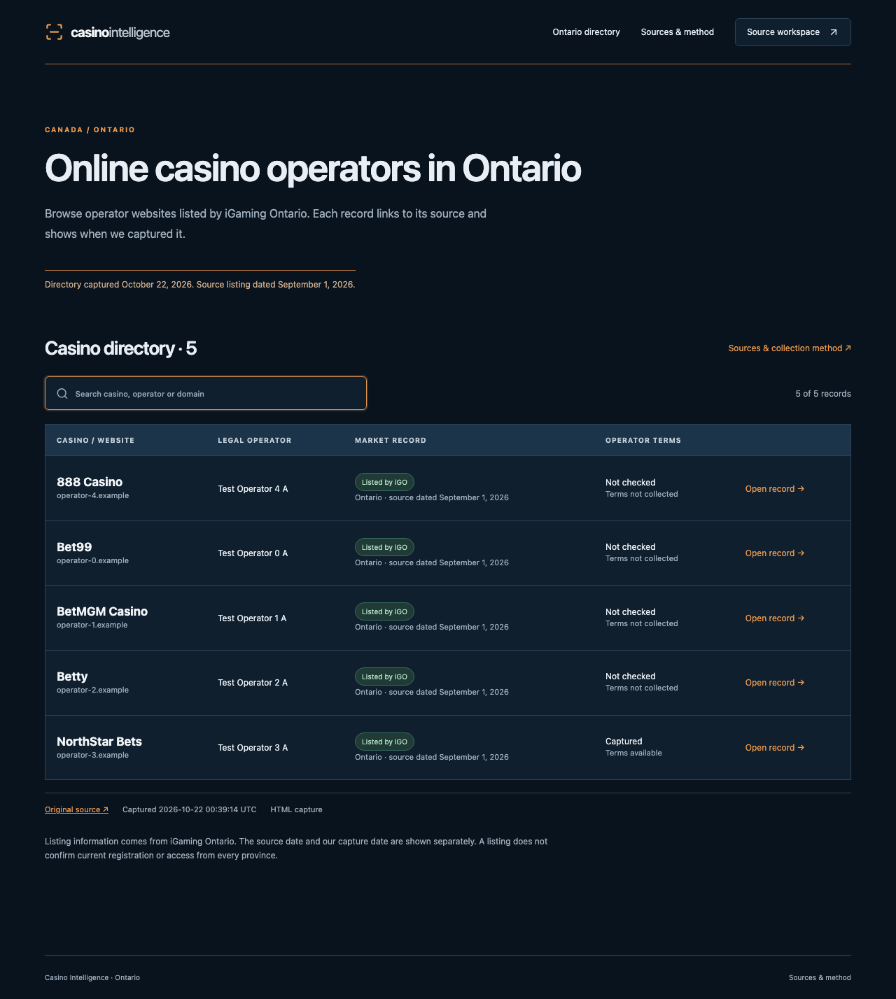
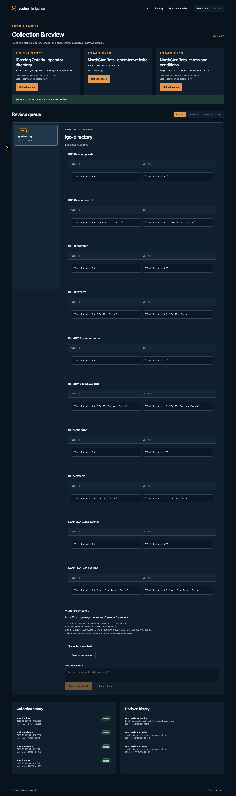
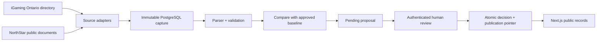

# Casino Intelligence

**Evidence-first research and publication workflow for regulated online-casino data.**

Casino Intelligence turns public-source research into a reviewable, auditable record:
collect a source, preserve the exact capture, extract only supported claims, compare the
observation with the approved version, and publish only after an authenticated human
decision.

It is deliberately not an affiliate site, a bonus scraper, or an LLM that silently fills
gaps. The product boundary is the interesting part: **a public page can only read the
current approved version**.



_Public directory view. The screenshot uses synthetic e2e data to demonstrate the UI._

## Why this project exists

Research systems often blur together “the source said this”, “we fetched this”, and
“someone decided to publish this”. That makes corrections hard to explain and stale data
easy to ship.

This project keeps those states separate:

- immutable source captures with URL, timestamp, method, hash and parser output;
- field-level provenance and evidence locations for every claim;
- pending proposals with a baseline and an explicit diff;
- authenticated approve/reject decisions with a rationale;
- atomic publication pointers and stale-review conflict detection;
- visible failures, unknowns and rejected proposals instead of silent fallbacks.

The current vertical slice covers a bounded Ontario sample: the iGaming Ontario operator
directory plus NorthStar Bets public website/terms. It is a research prototype, not a
claim that every operator, province or registration status has been verified.



_Review workspace. The screenshot uses synthetic e2e data; it does not represent a live
collection run._

## What is implemented

| Capability        | Implementation                                                                                  |
| ----------------- | ----------------------------------------------------------------------------------------------- |
| Source collection | Allow-listed HTTP and Playwright adapters for real public sources                               |
| Evidence          | Raw HTML/rendered DOM, SHA-256, capture time, final URL, parser version and locations           |
| Review            | Pending / approved / rejected / all queues with field-level published-vs-observed diffs         |
| Publication       | Human rationale required; decision, status and current pointer commit atomically                |
| Concurrency       | Stale approvals return a conflict; reviewed proposals are never silently rebased                |
| Idempotency       | Capture keys and semantic proposals deduplicate retries; rejected proposals are not resurrected |
| Public API        | Reads approved records only; raw source content is not served to the browser                    |
| SEO               | Off by default; when enabled, only confirmed published fields are emitted                       |

## Tech stack

- TypeScript, strict mode, pnpm
- Next.js 16 / React 19 for the public directory and editor workspace
- Fastify 5 for collection and publication commands
- PostgreSQL 17 + Drizzle ORM for immutable evidence and review history
- Zod for external-input validation
- Playwright for browser capture and end-to-end tests
- Vitest, ESLint, Prettier and Docker Compose

The architecture keeps business logic in `packages/` rather than React components or
route handlers. PostgreSQL is the source of truth; the web app is a reader of approved
records and a thin authenticated review client.

## Run locally

Requirements: Node 24, pnpm 11.21.0, Docker Desktop, and network access for the first
real collection.

```sh
pnpm install --frozen-lockfile
pnpm setup
docker compose up -d --wait
pnpm db:migrate
pnpm exec playwright install chromium
pnpm collect:real
pnpm dev
```

Open <http://127.0.0.1:3000>. Sign in at `/admin` with `ADMIN_PASSWORD` from the private
`.env` created by `pnpm setup`.

`pnpm collect:real` makes requests only to the configured allow-listed public sources and
creates pending proposals. It never publishes. Review the saved evidence, enter a
rationale, then approve or reject the proposal. Until approval, public pages remain on
the previous approved version.

For a production-like local run:

```sh
pnpm build
pnpm start
```

## Engineering checks

```sh
pnpm check             # agent contracts, types, lint, formatting, unit tests
pnpm test:integration  # isolated PostgreSQL schemas
pnpm test:e2e          # browser flow against isolated local data
pnpm verify            # all required gates plus build
```

The tests use synthetic inputs in isolated schemas. They do not overwrite collected data
or call casino sites.

## Architecture



The full boundary decisions and scaling notes are in [`docs/architecture.md`](docs/architecture.md).
The reproducible walkthrough is in [`docs/demo.md`](docs/demo.md), and source-specific
collection details are in [`docs/real-sources.md`](docs/real-sources.md).

## Honest scope and next steps

This repository intentionally does not include live LLM extraction, arbitrary URL
crawling, CAPTCHA bypass, accounts or deposits, Canadian-location verification, affiliate
tracking, or automatic publication. Those are product and risk decisions, not features to
smuggle into a prototype.

Natural next steps would be a durable scheduled worker with bounded concurrency, stronger
production auth/RBAC, object storage for larger immutable archives, and evaluation-backed
LLM assistance that can suggest observations but cannot publish them.

## License and source-use note

No open-source license has been selected yet. Add one before accepting external
contributions or presenting the repository as reusable software. Directory facts are
attributed to iGaming Ontario; commercial reuse of source material requires a rights
review. See the source-use section in [`docs/architecture.md`](docs/architecture.md).
