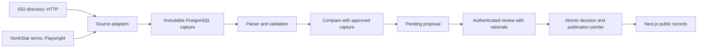

# Architecture and boundaries

Current scope: five Ontario operator identities and two NorthStar source documents.

Fastify owns collection/publication commands; services in `packages/research` own
business logic. Next.js server reads approved records from `/research`. The browser
writes through a same-origin proxy with an HttpOnly session and exact Origin check.
Only server code has the Fastify admin token. PostgreSQL is the source of truth.

`research_captures` stores raw HTML (rendered DOM for browser captures), SHA-256,
URL, timestamp, method, parsed payload, parser version and errors. Raw content is
not served to the browser. `research_proposals` stores immutable evidence references,
baseline and diff; only status changes. `research_decisions` is the append-only
review/audit record. An approved immutable capture acts as the published version;
`research_sources.current_capture_id` points to it. Capture/result/decision deletion
and mutation are rejected by database triggers. Legacy offer tables are archived,
not read by the current public API.

Approval locks the stable source row, then proposal. Decision, status and pointer
are written in one transaction. A stale baseline returns a conflict; it is never
silently rebased. Same decision is idempotent; opposite decision conflicts. Capture
keys deduplicate retries. Semantic proposals deduplicate against the same baseline,
including rejected proposals. New observations never resurrect rejected records.

Collection failures remain visible without changing published data. Missing tracked
operators fail parsing rather than silently removing them. Document hashes detect
changes even when extracted fields and character counts stay the same. Each claim
has an original source, capture time, method, snapshot and actual matching location.
A listing in iGO is not represented as a fresh AGCO licence check.

## Backend choice and scaling

Fastify keeps UI/API/collectors in TypeScript and the domain service independent of
React. Three fixed adapters do not need Redis or a queue yet. Before scheduled or
multi-instance crawling, move collection to a worker with durable jobs, bounded
concurrency, retries, per-domain rate limits and distributed capture identities.
PostgreSQL can hold this small snapshot volume; larger archives should use object
storage with immutable keys and database references. Public APIs still read approved
records only. Production requires SSO/RBAC, least-privilege DB roles, backups and monitoring.

## Current limits

- Fixed trusted source allowlist; no arbitrary user-supplied crawl URL.
- DNS checks reject private destinations, browser routing limits resources/redirects;
  DNS resolution is not pinned to the subsequent connection. Production collectors
  need isolated egress enforcement, response budgets and protection from DNS rebinding.
- Collection runs in the API process, not a scheduled durable worker.
- Single local editor account; process-local rate limiting and collection lock.
- No Canadian-location verification, no CAPTCHA bypass, no accounts or deposits.
- No live LLM, official partner API, paid traffic data or affiliate tracking.
- Directory publication is atomic per source; cross-source releases are not atomic.
- Proposal history is not paginated; recent logs are bounded but referenced evidence
  is loaded even when older than the recent-capture window.
